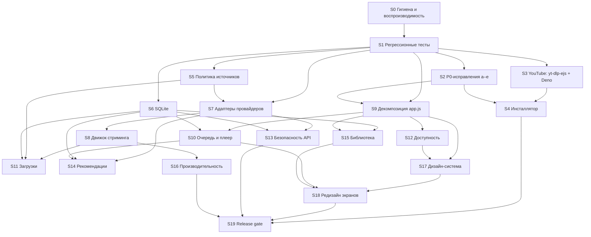

# Дорожная карта «ВОЛНА»

Основание: [REPOSITORY_AUDIT.md](REPOSITORY_AUDIT.md), [PRODUCT_GAP_ANALYSIS.md](PRODUCT_GAP_ANALYSIS.md), [TARGET_ARCHITECTURE.md](TARGET_ARCHITECTURE.md), [TEST_STRATEGY.md](TEST_STRATEGY.md).

## Правила исполнения

1. Работа ведётся в отдельных ветках от `main`. В `main` — только после согласования владельцем. Без force-push.
2. **Один этап — одна ветка, один логический слой — один коммит.** Архитектурные, визуальные и функциональные изменения не смешиваются.
3. Каждый этап начинается с тестов, которые фиксируют текущее поведение. Затем идёт изменение, затем отчёт по формату TEST_STRATEGY §10.
4. Следующий этап начинается только после подтверждения владельца.
5. Этап закрыт, когда выполнены все критерии приёмки. Критерии со статусом BLOCKED (Windows или live) явно перечисляются в отчёте. Этап считается «закрыт с ограничениями», пока они не выполнены на реальном окружении.
6. Если этап открывает новую зависимость или рискованный поворот архитектуры, сначала обновляется этот документ, затем согласование.

## Граф зависимостей

---

## P0 — честный работоспособный выпуск и безопасное развитие

### S0. Гигиена репозитория и воспроизводимость

Закрывает H4 (частично) и H5. Нужно ли окружение: нет.

| | |
|---|---|
| Изменения | `.gitignore`: `venv/ .venv/ .venv-build/ __pycache__/ *.pyc .idea/ .vscode/ build/ dist/ installer/MicrosoftEdgeWebview2Setup.exe packaging/runtime/deno/ tests/shots/ *.log .env cookies*.txt *.db`. `README.md`: назначение, требования (Python 3.12 для сборки, ≥ 3.10 для разработки), запуск в разработке, тесты, сборка, каталоги данных. Зависимости: `backend/requirements.txt` с runtime и точными версиями; `requirements-dev.txt` (pytest, playwright, pyflakes); `packaging/requirements-build.txt` с точными версиями; `constraints.txt` — снимок `pip freeze` из чистого venv на Python 3.12. Удаление неиспользуемого `sqlalchemy` (подтверждено: нет импортов); `certifi` объявлен явно. Защита e2e от реального профиля и временный каталог для скриншотов. Раннер `tests/run_e2e.py`. Удаление неиспользуемых импортов (L3). |
| Модули | `.gitignore`, `README.md`, `backend/requirements.txt`, `requirements-dev.txt`, `constraints.txt`, `packaging/requirements-build.txt`, `tests/e2e_smoke.py` (только защита и путь скриншотов), `tests/run_e2e.py`, `backend/main.py`, `backend/recs.py`, `backend/downloads.py` (импорты) |
| Тесты | e2e через раннер; проверка защиты: запуск против backend без временного профиля → отказ до первого действия |
| Критерии приёмки | (1) `git status` чистый после compileall, тестов и сборки (артефакты игнорируются). (2) В чистом venv `pip install -r backend/requirements.txt -r requirements-dev.txt -c constraints.txt` → **PASS**. (3) `python tests/run_e2e.py` → 109/109. (4) e2e против профиля без метки завершается с ошибкой и ничего не пишет. (5) README воспроизводим другим человеком по шагам. (6) Поведение приложения не изменилось. |
| Коммиты | `chore: restore .gitignore`; `docs: add README with dev/test/build instructions`; `build: split and pin dependencies, drop unused sqlalchemy`; `test: guard e2e against real user profile, add runner`; `chore: remove unused imports` |

### S1. Регрессионные тесты (characterization)

Закрывает H4. Зависит от S0. Окружение: нет; LIVE-1 и LIVE-6 — по возможности.

| | |
|---|---|
| Изменения | `tests/conftest.py` (изоляция §3 стратегии), фикстуры провайдеров, тесты из TEST_STRATEGY §5 с пометкой «S1». Код приложения **не меняется**. Дефекты, которые обнаружат тесты, фиксируются как `xfail(strict=True, reason="<ID находки>")` и исправляются на своём этапе. |
| Модули | только `tests/**`, `pytest.ini` (маркеры `live`, `windows`) |
| Тесты | `test_normalize_yt/sc`, `test_catalog_cards`, `test_ranges`, `test_stream_proxy`, `test_stream_local`, `test_stream_lifespan` (xfail M1), `test_search_isolation`, `test_recommendations`, `test_userdata`, `test_settings`, `test_playlists`, `test_downloads`, `test_lyrics` |
| Критерии приёмки | (1) `pytest -m "not live"` → PASS на Linux; xfail только с ID находок. (2) Покрыты все ветки Range: 200/206/416, суффикс, открытый конец, битый заголовок, протухшая ссылка, параллельный резолв = один вызов. (3) Тесты не обращаются в сеть: проверяется подменой транспорта, сетевой вызов роняет тест. (4) Ни один тест не пишет вне временного каталога. (5) e2e 109/109. |
| Коммиты | по группе: `test: add isolated pytest harness`; `test: track normalization`; `test: range parsing and stream proxy`; `test: sqlite user data and playlists`; `test: provider failure isolation`; `test: downloads and lyrics` |

### S2. P0-исправления

Каждый пункт — отдельный коммит с тестом. Зависит от S1.

| Пункт | Что | Модули | Тесты и проверки | Критерии приёмки | Окружение |
|---|---|---|---|---|---|
| **S2a** (H3) | Настройки UI в SQLite через `/api/settings`: `volume`, `last_volume`, `lyrics_visible`, `profile_name`, `mix_covers`; однократная миграция из localStorage; debounce записи громкости; `GET /api/boot.js` для темы без мигания | `backend/userdata.py`, `backend/main.py` (boot.js), `frontend/app.js` (LS → settings), `frontend/index.html` | `test_settings.py`: новые ключи, валидация, сохранение между двумя запусками backend на одном профиле; **e2e**: выставить настройки на порту A, перезапустить backend на порту B с тем же профилем → значения на месте | API аддитивен, старые ключи и ответы не изменились; e2e-проверка смены порта PASS; WIN-5 PASS на Windows | Windows — WIN-5 |
| **S2b** (M1) | Асинхронное состояние резолвера в `lifespan` (`app.state.resolver`) | `backend/stream.py`, `backend/main.py` | `test_stream_lifespan` из xfail → PASS; весь `test_stream_proxy` PASS | два lifespan подряд без `RuntimeError`; WIN-12 PASS | Windows — WIN-12 |
| **S2c** (M4) | `/api/recommendations` возвращает `failed_sources` и `source_status`; при пустом результате из-за сбоя фронтенд пишет «Источник сейчас недоступен» с кнопкой «Повторить»; `personalized` честный | `backend/recs.py`, `frontend/app.js` | `test_recommendations`: сбой → `failed_sources`; e2e: мок 502 от источника → видимое сообщение | пользователь отличает «нет данных» от «источник недоступен»; поле аддитивно | — |
| **S2d** (L6) | Человеческие тексты ошибок стрима: «нет сети» отдельно от «yt-dlp/куки» | `backend/stream.py` | `test_stream_proxy`: тексты по типам ошибок | нет вводящих в заблуждение сообщений | — |
| **S2e** (M13) | Описательные названия вместо «Моя волна», «Открытия недели», «Встряхнуть мою волну», «Под твою волну» (тексты — PRODUCT_GAP_ANALYSIS §3, финал утверждает владелец) | `frontend/index.html`, `frontend/app.js`, `tests/e2e_smoke.py` (условие готовности в строке 176 — в том же коммите, см. PRODUCT_GAP_ANALYSIS §3) | e2e 109/109 с обновлёнными ожиданиями | в UI нет фирменных названий конкурентов; число проверок не уменьшилось | — |

### S3. YouTube в распространяемой версии: `yt-dlp-ejs` и Deno

Закрывает H1 и L8. Зависит от S1. Окружение: **Windows и live обязательны**.

| | |
|---|---|
| Изменения | `yt-dlp[default]==<версия>` в зависимостях. `backend/jsruntime.py`: поиск, проверка версии, кэш (TARGET_ARCHITECTURE §4). `ydl_opts()` передаёт `js_runtimes`; задаются `DENO_DIR` и `DENO_NO_UPDATE_CHECK`. `GET /api/diagnostics`. `launcher.py --diagnostics [--live <id>]`. `packaging/runtime/deno.lock` (версия, URL, SHA-256), загрузка и сверка хэша в `build_windows.bat`, `licenses/` и `THIRD_PARTY_NOTICES.txt`, `wave.spec` (`runtime/`, `licenses/`). Понятное сообщение UI, если runtime не найден. |
| Модули | `backend/requirements.txt`, `constraints.txt`, `backend/jsruntime.py` (новый), `backend/stream.py` (`ydl_opts`), `backend/soundcloud.py` (общие `ydl_opts`), `backend/main.py` (diagnostics), `backend/launcher.py`, `packaging/wave.spec`, `packaging/runtime/deno.lock`, `build_windows.bat`, `licenses/**`, `frontend/app.js` (сообщение) |
| Тесты | `test_jsruntime.py`; `test_stream_proxy` без регрессий; LIVE-2, LIVE-3, LIVE-4; WIN-1, WIN-6, WIN-7 |
| Критерии приёмки | (1) Unit-тесты PASS на Linux и Windows. (2) `Wave.exe --diagnostics` в собранной папке сообщает runtime `deno <версия ≥ 2.3.0> supported=true` и `yt_dlp_ejs` с версией. (3) **LIVE-2/LIVE-3 PASS в собранном приложении на Windows**: публичный трек стартует, перемотка работает. (4) WIN-7: после закрытия нет `deno.exe`. (5) Нет окна консоли при резолве. (6) Лицензии в комплекте. (7) Размер дистрибутива до и после зафиксирован в отчёте. **До выполнения 3–5 проблема H1 не считается исправленной.** |
| Коммиты | `build: require yt-dlp[default] (yt-dlp-ejs)`; `feat(stream): resolve and verify JS runtime for yt-dlp`; `feat: diagnostics endpoint and --diagnostics flag`; `build: bundle pinned Deno with checksum and licenses` |

### S4. Инсталлятор

Закрывает H2. Зависит от S3 (состав сборки) и S2 (версия и настройки). Окружение: **Windows обязательно**.

| | |
|---|---|
| Изменения | `installer/wave.iss` по TARGET_ARCHITECTURE §12: per-user установка, WebView2-bootstrapper, `AppMutex`, данные пользователя сохраняются. `backend/version.py` — единый источник версии. `build_windows.bat`: `mkdir installer`, проверка `--diagnostics`, `/DAppVersion`. `WAVE_PORT` (только переменная окружения, для WIN-13). Удаление `make_icon.py` (L4) — после подтверждения, что он не используется. |
| Модули | `installer/wave.iss` (новый), `build_windows.bat`, `packaging/wave.spec`, `backend/version.py` (новый), `backend/main.py` (версия API), `backend/launcher.py` (`WAVE_PORT`), `packaging/make_icon.py` |
| Тесты | WIN-1…WIN-4, WIN-8, WIN-9, WIN-13, WIN-15 |
| Критерии приёмки | (1) Чистая машина: `build_windows.bat` даёт `dist\installer\Wave-Setup-<версия>.exe`. (2) Установка без прав администратора; запуск; воспроизведение (вместе с S3). (3) Обновление поверх сохраняет данные. (4) Удаление не трогает `%LOCALAPPDATA%\Wave` и загрузки. (5) В дистрибутиве нет пользовательских данных и секретов (WIN-15). (6) Инсталлятор устанавливает настоящую собранную папку `dist\Wave`, а не заглушку. |
| Коммиты | `build: single version source`; `build(installer): add Inno Setup script`; `build: fix build_windows.bat installer steps and add diagnostics gate` |

### S5. Политика источников и скачивание

Зависит от S1. Окружение: live LIVE-5. **Нужны решения владельца: ADR-5, ADR-6.**

| | |
|---|---|
| Изменения | `providers/policy.py` с матрицей возможностей (TARGET_ARCHITECTURE §6). `POST /api/downloads` → 403 `download_not_allowed` для источников без разрешения. Фронтенд: вместо кнопки «Скачать» — пояснение. Уже скачанные треки играют и удаляются как раньше. SoundCloud: атрибуция (автор и ссылка на SoundCloud) на странице трека и в плеере; режим «без смешивания» или флаг `WAVE_SC_ENABLED` — по решению владельца. Тексты ошибок по типам `ProviderError`. |
| Модули | `backend/providers/policy.py` (новый), `backend/downloads.py`, `backend/soundcloud.py`, `backend/main.py`, `frontend/app.js`, `frontend/index.html` |
| Тесты | `test_policy.py`; `test_downloads` (403); e2e: кнопка скачивания показывает пояснение, «Скачанные» с уже существующим файлом воспроизводятся |
| Критерии приёмки | (1) Ни один путь API и UI не начинает скачивание для источника с `download_allowed=False`. (2) Существующие загрузки не удалены и играют (проверка на фикстуре профиля с загрузкой). (3) Атрибуция SoundCloud видна везде, где играет его трек. (4) Решения ADR-5 и ADR-6 зафиксированы в TARGET_ARCHITECTURE §14. |
| Коммиты | `feat(policy): source capability matrix`; `feat(downloads): enforce download policy`; `feat(ui): explain unavailable downloads and SoundCloud attribution` |

---

## P1 — качество основных сценариев

### S6. Хранилище SQLite

Закрывает M5 и M6 (хранение). Зависит от S1.

- **Изменения.** `persistence/db.py` (PRAGMA, `transaction()`), `migrations.py` (`user_version`, v1 — текущая схема, бэкап `sqlite3.backup()`, хранятся три копии), репозитории. Атомарные операции с плейлистами. Ретеншн истории. Поля `explicit`, `plays`, `released` в `TrackIn`.
- **Модули.** `backend/library.py`, `backend/userdata.py`, `backend/playlists.py`, новые `backend/persistence/*`.
- **Тесты.** `test_db_migrations.py` на фикстурах баз «5a7f27c» и «без `downloads.root`»; `test_playlists` (конкурентное добавление → без 500, xfail снимается); `test_userdata` (поля сохраняются).
- **Критерии приёмки.**
  1. Миграция реальной структуры базы без потери строк, по количеству и выборочному содержимому.
  2. Бэкап создаётся до миграции.
  3. Сбой миграции даёт откат.
  4. Повторный запуск идемпотентен.
  5. e2e 109+.

### S7. Адаптеры провайдеров

Закрывает M2, M3, M9, M10 (частично). Зависит от S1 и S5. Live: LIVE-1, LIVE-5.

- **Изменения.** `providers/base.py` (Protocol, ошибки, cooldown для всех, пул потоков на провайдер), `youtube_music.py`, `soundcloud.py`, ограниченные LRU+TTL-кэши, `source_status` в ответах поиска.
- **Модули.** `backend/main.py`, `backend/catalog.py`, `backend/soundcloud.py`, `backend/recs.py`, `backend/lyrics.py`, новые `backend/providers/*`.
- **Тесты.** `test_search_isolation` (зависший провайдер не блокирует второй и не исчерпывает общий пул), тесты кэшей (лимит и TTL), прежние тесты нормализации без изменений.
- **Критерии приёмки.**
  1. Зависание одного источника на 30 с не задерживает ответы другого источника и SQLite-эндпоинтов.
  2. YouTube получает cooldown.
  3. Кэши ограничены.
  4. Ответы аддитивны: `failed_sources` сохранён.
  5. LIVE-1 PASS.

### S8. Движок стриминга

Закрывает L2 и структуру M1. Зависит от S7.

- **Изменения.** `streaming/ranges.py` (чистые функции), `resolver.py`, `proxy.py`, `local.py`, `router.py`. Поддержка `HEAD`; битый Range → 200.
- **Тесты.** Все тесты стрима; добавлены `HEAD` и битый Range; LIVE-3.
- **Критерии приёмки.**
  1. Поведение 200/206/416 и перерезолва идентично зафиксированному в S1.
  2. `HEAD` → 200 с заголовками.
  3. e2e: seek, pause/resume, переключение, локальные файлы — PASS.

### S9. Декомпозиция `frontend/app.js`

Закрывает M11. Зависит от S1 и S2.

- **Изменения.** Переход на ES-модули по TARGET_ARCHITECTURE §11, в порядке `core` → `components` → `player/queue` → `player/controller` → `views`. Без визуальных и функциональных изменений.
- **Модули.** `frontend/index.html` (`type="module"`), `frontend/app.js` → `frontend/js/**`.
- **Тесты.** `node --test tests/js` (`queue`, `format`); e2e 109/109 **после каждого коммита**; скриншоты до и после на 980/1366/1440/1920 совпадают визуально.
- **Критерии приёмки.**
  1. Каждый шаг — отдельный коммит с зелёным e2e.
  2. Модель очереди не делит массив со списком экрана (тест: сортировка списка не меняет очередь).
  3. Нет потери функций по чек-листу экранов.

### S10. Очередь и плеер

Закрывает M14. Зависит от S9 и S6. Windows: WIN-11.

- **Изменения.** Shuffle без повторов с историей для «назад»; repeat off/one/all; восстановление очереди и позиции после перезапуска (сериализация модели в SQLite через settings или отдельную таблицу — решается на этапе); запись в историю после порога (30 с или 50 % длительности, что раньше) с сохранением сигнала пропуска; «Открыть альбом» по ID, где источник его даёт; событие `offline` больше не уводит с экрана, а показывает баннер со ссылкой на «Скачанные».
- **Тесты.** `queue.test.mjs` (все режимы); e2e: повтор очереди, shuffle без повторов на 10 треках, восстановление после перезагрузки страницы; `test_userdata` (порог записи).
- **Критерии приёмки.** Перечисленное поведение подтверждено тестами; WIN-11 PASS.

### S11. Загрузки (для разрешённого контента)

Закрывает M8. Зависит от S8, S5, S6. Windows: WIN-14.

- **Изменения.** `DownloadManager` (лимит, отмена, `to_thread` для записи, восстановление и очистка `.part` во всех `root`), изоляция сбоев текстов и обложек, отмена в UI.
- **Тесты.** `test_downloads`: отмена, лимит, сбой LRCLIB (xfail снимается), завершение приложения посередине → чистый старт.
- **Критерии приёмки.**
  1. Отмена освобождает ресурсы и удаляет `.part`.
  2. Не больше N параллельных загрузок.
  3. Битый ответ текстов не ломает загрузку.

### S12. Доступность

Закрывает M12. Зависит от S9.

- **Изменения.** Ссылки на артистов — фокусируемые элементы вне `button.track`, без вложенных интерактивных элементов; «Загрузить ещё» — настоящая `button`; меню: стрелки, Home/End, возврат фокуса; проверка контраста токенов.
- **Тесты.** e2e: Tab-обход ключевых экранов, открытие артиста с клавиатуры, меню стрелками; автоматическая проверка ролей и имён (сценарий Playwright без новых зависимостей).
- **Критерии приёмки.** Все основные сценарии выполнимы без мыши; e2e PASS.

### S13. Безопасность локального API

Закрывает M7, M6 (валидация), L1. Зависит от S7 и S6.

- **Изменения.** `OriginGuard`, серверная валидация `TrackIn` (`stream_url` вычисляется сервером, URL обложек из allowlist), маскирование трейсбеков, фильтрация невалидных старых строк при чтении.
- **Тесты.** `test_origin_guard`, `test_userdata` (валидация), тест маскирования журнала.
- **Критерии приёмки.**
  1. Кросс-доменный POST → 403.
  2. Фронтенд и e2e работают без изменений.
  3. В журнале нет подписей URL и IP из googlevideo.

---

## P2 — развитие продукта

| Этап | Содержание | Зависимости | Ключевые критерии приёмки |
|---|---|---|---|
| **S14. Рекомендации** | Явное «не рекомендовать трек/артиста» (таблица исключений), сброс сигналов, разнообразие (ограничение по артисту и альбому, новизна), видимые причины «почему этот трек», офлайн-оценка на фикстурах истории (метрики: доля новых артистов, повторы, доля пропусков). Собственная функция бренда «ВОЛНА» — после утверждения названия. Без ML и без выдуманных жанров и трендов | S7, S6, S10 | детерминированные тесты скоринга; метрики на фикстурах не хуже базовой линии; LIVE-7 |
| **S15. Библиотека** | Избранные альбомы и артисты, поиск и фильтры по коллекции, ручной порядок в плейлистах (`PATCH .../tracks/order`), удаление записи истории, экспорт и импорт JSON (избранное, плейлисты, настройки), импорт локальных аудиофайлов как источник `local` | S6, S9 | экспорт → импорт в чистый профиль восстанавливает данные 1:1; миграции схемы по S6; e2e |
| **S16. Наблюдаемость и производительность** | Тайминги холодного старта, лимиты памяти кэшей, профилирование длинных списков (виртуализация при необходимости), экран «О программе / Диагностика» | S8 | холодный старт и память измерены и зафиксированы; нет регрессии относительно базовой линии |
| **S17. Дизайн-система «ВОЛНА»** | Токены: глубокий графит, сине-бирюзовая шкала, точечные золотисто-оранжевые акценты, фирменная волна; типографика, отступы, движение, состояния фокуса; компоненты. Без изменения поведения. Фокус на уже открытом окне при повторном запуске (L5) | S9, S12 | контраст AA для текста; e2e 109+; скриншоты всех экранов в двух темах |
| **S18. Редизайн экранов** | Главная, поиск, артист/альбом, коллекция, плеер, очередь, тексты, плейлисты, загрузки, настройки, все состояния (пусто, загрузка, ошибка, повтор). Свой визуальный язык, без копирования конкурентов | S17, S10, S15 | e2e обновлён вместе с разметкой без уменьшения проверок; визуальный обзор на 980–1920; клавиатура |
| **S19. Release gate** | Полный прогон: unit, API, e2e, live-канарейки, Windows-чек-лист WIN-1…15 на двух ОС, чистая установка и обновление, итоговые документы и честный отчёт | S4, S18, S13, S16 | все критерии PASS или явно согласованные исключения |

---

## Сводка затрагиваемых модулей

| Модуль | Этапы |
|---|---|
| `backend/main.py` | S0, S2a, S2b, S3, S4, S5, S7 |
| `backend/launcher.py` | S3, S4, S17 |
| `backend/stream.py` → `streaming/*` | S2b, S2d, S3, S8 |
| `backend/catalog.py`, `soundcloud.py` → `providers/*` | S3, S5, S7 |
| `backend/recs.py` | S0, S2c, S7, S14 |
| `backend/library.py`, `userdata.py`, `playlists.py` → `persistence/*` | S2a, S6, S13, S15 |
| `backend/downloads.py` → `jobs/*` | S0, S5, S11 |
| `backend/lyrics.py` | S7, S11 |
| `backend/applog.py` | S13 |
| `backend/paths.py` | S3 (`resource_dir` для runtime), S15 |
| новые: `jsruntime.py`, `version.py`, `providers/policy.py`, `persistence/*`, `streaming/*` | S3, S4, S5, S6, S8 |
| `frontend/app.js` → `frontend/js/**` | S2a, S2c, S2e, S3, S5, S9–S12, S14–S18 |
| `frontend/index.html`, `style.css` | S2a, S2e, S5, S9, S12, S17, S18 |
| `tests/e2e_smoke.py` | S0, S2a, S2c, S2e, S5, S10, S12, S18 |
| `packaging/wave.spec`, `build_windows.bat`, `installer/wave.iss` | S3, S4 |
| зависимости | S0, S3 |

## Что требует Windows и живых источников

| Этап | Windows | Живые источники |
|---|---|---|
| S0, S1 | — | LIVE-1, LIVE-6 (по возможности) |
| S2 | WIN-5 (S2a), WIN-12 (S2b) | — |
| S3 | WIN-1, WIN-6, WIN-7 — **обязательно** | LIVE-2, LIVE-3, LIVE-4 — **обязательно** |
| S4 | WIN-1…4, 8, 9, 13, 15 — **обязательно** | — |
| S5 | — | LIVE-5 |
| S7 | WIN-10 | LIVE-1, LIVE-5 |
| S8 | — | LIVE-3 |
| S10 | WIN-11 | — |
| S11 | WIN-14 | — |
| S14 | — | LIVE-7 |
| S19 | все WIN | все LIVE |

В текущей облачной среде Windows недоступна, а YouTube и SoundCloud заблокированы сетью. Эти проверки выполняет владелец на своей машине по чек-листу TEST_STRATEGY §7–8 либо в настроенном CI или на ВМ с доступом к сети. Результаты вносятся в таблицу статуса ниже.

## Статус этапов

| Этап | Статус | Ветка | Примечание |
|---|---|---|---|
| Аудит и документация | готово, ждёт согласования | `claude/engineering-docs` | этот набор документов |
| S0–S19 | не начато | — | старт после согласования плана |
