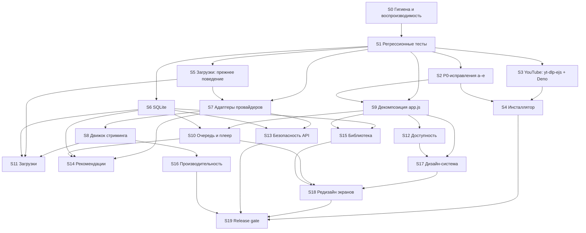

# Дорожная карта «ВОЛНА»

Основание: [REPOSITORY_AUDIT.md](REPOSITORY_AUDIT.md), [PRODUCT_GAP_ANALYSIS.md](PRODUCT_GAP_ANALYSIS.md), [TARGET_ARCHITECTURE.md](TARGET_ARCHITECTURE.md), [TEST_STRATEGY.md](TEST_STRATEGY.md).

## Правила исполнения

1. Работа ведётся в отдельных ветках от `main`. В `main` — только после согласования владельцем. Без force-push.
2. **Один этап — одна ветка, один логический слой — один коммит.** Архитектурные, визуальные и функциональные изменения не смешиваются.
3. Каждый этап начинается с тестов, которые фиксируют текущее поведение. Затем идёт изменение, затем отчёт по формату TEST_STRATEGY §10.
4. Следующий этап начинается только после подтверждения владельца.
5. Этап закрыт, когда выполнены все критерии приёмки. Критерии со статусом BLOCKED (Windows или live) явно перечисляются в отчёте. Этап считается «закрыт с ограничениями», пока они не выполнены на реальном окружении.
6. Если этап открывает новую зависимость или рискованный поворот архитектуры, сначала обновляется этот документ, затем согласование.

## Граф зависимостей

---

## P0 — честный работоспособный выпуск и безопасное развитие

### S0. Гигиена репозитория и воспроизводимость

Закрывает H4 (защита данных в e2e) и H5. Окружение: нет.

**Статус: выполнено 2026-10-12, ветка `claude/s0-repository-hygiene`; отчёт — [reports/S0.md](reports/S0.md).**

| | |
|---|---|
| Изменения | `.gitignore` (сборка, окружения, базы, журналы, медиа, секреты, скриншоты). `.gitattributes`: LF в репозитории, CRLF при checkout для `.bat/.cmd/.iss`. `README.md`: требования, установка, запуск, тесты, сборка, переменные окружения, ограничения. Зависимости: runtime в `backend/requirements.txt` без `sqlalchemy`, с явным `certifi`, нижние границы не менялись; `requirements-dev.txt` (playwright 1.56.0, pyflakes 3.4.0); `constraints.txt` — снимок чистого venv на Python 3.12; `build_windows.bat` ставит зависимости с `-c constraints.txt`. Зависимости сборки пока не закреплены, перенесено в S3–S4: закрепление без проверки сборки на Windows было бы непроверенным. Защита e2e от реального профиля, скриншоты во временную папку. Раннеры `tests/run_e2e.py` и `tests/run_checks.py` (гигиена git, compileall, pyflakes, node, e2e). Удалены три неиспользуемых импорта и переменная (L3). `pytest` появится в S1 вместе с тестами. |
| Модули | `.gitignore`, `.gitattributes`, `README.md`, `backend/requirements.txt`, `requirements-dev.txt`, `constraints.txt`, `packaging/requirements-build.txt`, `build_windows.bat` (одна строка), `tests/e2e_smoke.py` (только защита и путь скриншотов), `tests/run_e2e.py`, `tests/run_checks.py`, `backend/main.py`, `backend/recs.py`, `backend/downloads.py` (импорты) |
| Тесты | `tests/run_checks.py`; отказ e2e на нетестовом профиле; BLOCKED без Playwright и pyflakes |
| Критерии приёмки | (1) `git status` чистый после всех проверок — **PASS**. (2) Чистый venv: `pip install … -c constraints.txt` → **PASS**, `pip freeze` совпадает с `constraints.txt`. (3) e2e через раннер 109/109 — **PASS** (Linux, Chromium 141). (4) e2e против профиля без метки → код 2, база не изменена — **PASS**. (5) README по шагам на Linux — **PASS**; на Windows — **NOT RUN**. (6) Поведение приложения не изменилось — **PASS** (в коде приложения удалены только импорты; e2e 109/109). |
| Коммиты | `8c7e502` chore: restore .gitignore · `f25786a` build: split runtime/dev dependencies and add tested constraints · `055817e` chore: add .gitattributes · `9f5b172` test: guard e2e against the real user profile, add runners · `c742b02` chore: remove unused imports · `cd71320` docs: add README · документация и отчёт — следующим коммитом |

### S1. Регрессионные тесты (characterization)

Закрывает H4. Зависит от S0. Окружение: нет; LIVE-1 и LIVE-6 — по возможности.

**Статус: выполнено 2026-10-13, ветка `claude/s1-regression-tests` (от `claude/s0-repository-hygiene`); отчёт — [reports/S1.md](reports/S1.md).** Итог: 395 тестов pytest (379 PASS, 16 strict xfail с ID находок, 0 FAIL), e2e 109/109, CI зелёный на Linux и Windows. Код приложения не менялся. Отклонения от плана: маркер `windows` не заведён (Windows-only автотестов пока нет, Windows-job гоняет весь набор); добавлены тесты, которых не было в плане: `test_isolation`, `test_track_contract`, `test_catalog_api`, `test_local_api_security`, `test_sqlite_schema`, `test_lyrics_api`.

| | |
|---|---|
| Изменения | `tests/conftest.py` (изоляция §3 стратегии), фикстуры провайдеров, тесты из TEST_STRATEGY §5 с пометкой «S1». Код приложения **не меняется**. Дефекты, которые обнаружат тесты, фиксируются как `xfail(strict=True, reason="<ID находки>")` и исправляются на своём этапе. **CI (ADR-8)**: GitHub Actions — `ubuntu-latest`: `run_checks.py` (с pytest и e2e); `windows-latest`: `run_checks.py` (с pytest и e2e в Chromium) и сборка `dist\Wave` через PyInstaller как проверка spec. Шаг установщика добавляется в S4. Без секретов и без обращений к живым источникам. |
| Модули | `tests/**`, `pytest.ini` (маркеры `live`, `windows`), `requirements-dev.txt` (+ pytest), `constraints.txt`, `tests/run_checks.py` (+ шаг pytest), `.github/workflows/ci.yml` (новый) |
| Тесты | `test_normalize_yt/sc`, `test_catalog_cards`, `test_ranges`, `test_stream_proxy`, `test_stream_local`, `test_stream_lifespan` (xfail M1), `test_search_isolation`, `test_recommendations`, `test_userdata`, `test_settings`, `test_playlists`, `test_downloads`, `test_lyrics` |
| Результат по критериям | (1) `python -m pytest` → **PASS** на Linux (Python 3.12.3) и в CI на `ubuntu-latest` и `windows-latest`; xfail только с ID: H3, L2, M1, M3, M4, M5, M6, M7, M8. (2) Ветки Range покрыты — **PASS**: `test_ranges`, `test_stream_proxy`, `test_stream_local`. (3) Сеть: аудит-хук блокирует любые не-loopback соединения, нарушение роняет тест даже при перехвате исключения в коде приложения; `FakeNet` роняет тест на неизвестный хост — **PASS** (`test_isolation`). (4) Запись вне временного каталога заблокирована тем же хуком; реальные каталоги сверяются в конце сессии — **PASS**. (5) e2e 109/109 — **PASS** (Linux Chromium; в CI ещё и Windows Chromium, не WebView2). (6) CI — **PASS**: [run 38310405338](https://github.com/Andrey3269/Wave/actions/runs/38310405338) (`checks (ubuntu-latest)`, `checks (windows-latest)`, `windows-build`). LIVE-1, LIVE-6 — **BLOCKED** (сеть среды: прокси отвечает 403 для music.youtube.com и lrclib.net). |
| Критерии приёмки | (1) `pytest -m "not live"` → PASS на Linux; xfail только с ID находок. (2) Покрыты все ветки Range: 200/206/416, суффикс, открытый конец, битый заголовок, протухшая ссылка, параллельный резолв = один вызов. (3) Тесты не обращаются в сеть: проверяется подменой транспорта, сетевой вызов роняет тест. (4) Ни один тест не пишет вне временного каталога. (5) e2e 109/109. (6) Оба job'а CI зелёные на ветке; ссылка на запуск в отчёте этапа. |
| Коммиты | `d230205` test: add isolated pytest harness · `25cbc0c` test: track normalization and Track contract · `334e678` test: range parsing, stream proxy, local playback and restarts · `f5d2471` test: sqlite user data, settings and playlists · `c871d23` test: provider failure isolation, catalog and recommendations · `7f7c49d` test: downloads and lyrics · `83f6c6b` ci: GitHub Actions checks on Linux and Windows, PyInstaller spec build · `0334321` test: default Content-Type when the CDN sends none · документация и отчёт — следующим коммитом |

### S2. P0-исправления

Каждый пункт — отдельный коммит с тестом. Зависит от S1.

**Статус: выполнено 2026-10-13, принято владельцем 2026-10-13 с ограничениями (WIN-5, WIN-12 — NOT RUN), ветка `claude/s2-p0-fixes` (от `claude/s1-regression-tests`, `6401e94`); отчёт — [reports/S2.md](reports/S2.md).** Итог: pytest 469 PASS + 13 strict xfail (снято 3: H3, M1, M4), e2e: smoke 122 проверки (было 109) + новый `e2e_settings.py` 24 проверки (три запуска backend: порт A, порт B, чистый профиль), 0 FAIL. Коммиты: `1070aa8` S2a · `b72b6cd` S2b · `21ddcab` S2c · `259599c` S2d · `4df5b50` S2e. WIN-5 и WIN-12 — **NOT RUN** (нужна Windows с WebView2), этап «закрыт с ограничениями» до их выполнения.

Отклонения от плана в таблице ниже:
- **S2a.** Кроме ключей добавлены служебная отметка переноса (`meta.local_ui_migrated`) и отдельный `POST /api/settings/migrate-local`: перенос выполняется на сервере один раз на профиль и пишет только отсутствующие ключи, поэтому устаревший localStorage другого порта не затирает новые значения. Запись `PUT /api/settings` атомарна (N1). Тело `PUT` теперь `dict[str, Any]`: число в прежнем ключе даёт 400 «Недопустимое значение настройки.» вместо 422 FastAPI. e2e смены порта вынесен в `tests/e2e_settings.py` (раннер перезапускает backend на другом порту с тем же профилем); в pytest — `ApiHarness.serve()`, два настоящих uvicorn на разных портах.
- **S2b.** Название `stream.ResolverState` (`app.state.resolver`); кроме семафора в нём задачи резолва, ключи прогрева и фоновые задачи. Ссылки (`_cache`) и «головы» (`_heads`) остались данными процесса.
- **S2c.** Кроме `failed_sources` и `source_status` добавлено поле `radio` (план из PRODUCT_GAP_ANALYSIS §3: «радио трека отдельным полем»).
- **S2d.** Статусы: нет сети, ограничение частоты и проверка «не бот» — 503 (было 502); «Requested format is not available» — 502 `extractor` (было 404 «Трек недоступен»). Новый заголовок `X-Wave-Error` с типом ошибки.
- **S2e.** Тексты из PRODUCT_GAP_ANALYSIS §3 с уточнениями: заголовок ряда миксов зависит от того, есть ли в нём радио по истории («Миксы по вашим трекам» / «Тематические миксы»); подпись ленты: «Подобрано по вашей истории» / «Похоже на текущий трек» / «С чего начать» / «Подборка». **Тексты утверждены владельцем 2026-10-13.**

| Пункт | Что | Модули | Тесты и проверки | Критерии приёмки | Окружение |
|---|---|---|---|---|---|
| **S2a** (H3) | Настройки UI в SQLite через `/api/settings`: `volume`, `last_volume`, `lyrics_visible`, `profile_name`, `mix_covers`; однократная миграция из localStorage; debounce записи громкости; `GET /api/boot.js` для темы без мигания | `backend/userdata.py`, `backend/main.py` (boot.js), `frontend/app.js` (LS → settings), `frontend/index.html` | `test_settings.py`: снять xfail `test_ui_settings_are_persisted_by_backend` (H3), новые ключи, валидация, сохранение между двумя запусками backend на одном профиле (образец — `test_settings_survive_backend_restart`); **e2e**: выставить настройки на порту A, перезапустить backend на порту B с тем же профилем → значения на месте | API аддитивен, старые ключи и ответы не изменились; e2e-проверка смены порта PASS; WIN-5 PASS на Windows | Windows — WIN-5 |
| **S2b** (M1) | Асинхронное состояние резолвера в `lifespan` (`app.state.resolver`) | `backend/stream.py`, `backend/main.py` | `test_stream_lifespan.py::test_restart_after_contention_keeps_resolving` из xfail → PASS; убрать сброс `_resolve_sem` в `tests/conftest.py:reset_backend_state`; весь `test_stream_proxy` PASS | два lifespan подряд без `RuntimeError`; WIN-12 PASS | Windows — WIN-12 |
| **S2c** (M4) | `/api/recommendations` возвращает `failed_sources` и `source_status`; при пустом результате из-за сбоя фронтенд пишет «Источник сейчас недоступен» с кнопкой «Повторить»; `personalized` честный | `backend/recs.py`, `frontend/app.js` | `test_recommendations.py::test_all_candidate_sources_failed_is_reported` из xfail → PASS, `test_all_candidate_sources_failed_returns_empty_200` обновить; e2e: мок 502 от источника → видимое сообщение | пользователь отличает «нет данных» от «источник недоступен»; поле аддитивно | — |
| **S2d** (L6) | Человеческие тексты ошибок стрима: «нет сети» отдельно от «yt-dlp/куки» | `backend/stream.py` | `test_ranges.py::test_network_failure_message_is_misleading` заменить проверкой новых текстов по типам ошибок | нет вводящих в заблуждение сообщений | — |
| **S2e** (M13) | Описательные названия вместо «Моя волна», «Открытия недели», «Встряхнуть мою волну», «Под твою волну» (тексты — PRODUCT_GAP_ANALYSIS §3, финал утверждает владелец) | `frontend/index.html`, `frontend/app.js`, `tests/e2e_smoke.py` (условие готовности в строке 176 — в том же коммите, см. PRODUCT_GAP_ANALYSIS §3) | e2e 109/109 с обновлёнными ожиданиями | в UI нет фирменных названий конкурентов; число проверок не уменьшилось | — |

### S3. YouTube в распространяемой версии: `yt-dlp-ejs` и Deno

Закрывает H1 и L8. Зависит от S1. Окружение: **Windows и live обязательны**.

| | |
|---|---|
| Изменения | `yt-dlp[default]==<версия>` в зависимостях. `backend/jsruntime.py`: поиск, проверка версии, кэш (TARGET_ARCHITECTURE §4). `ydl_opts()` передаёт `js_runtimes`; задаются `DENO_DIR` и `DENO_NO_UPDATE_CHECK`. `GET /api/diagnostics`. `launcher.py --diagnostics [--live <id>]`. `packaging/runtime/deno.lock` (версия, URL, SHA-256), загрузка и сверка хэша в `build_windows.bat`, `licenses/` и `THIRD_PARTY_NOTICES.txt`, `wave.spec` (`runtime/`, `licenses/`). Понятное сообщение UI, если runtime не найден. |
| Модули | `backend/requirements.txt`, `constraints.txt`, `backend/jsruntime.py` (новый), `backend/stream.py` (`ydl_opts`), `backend/soundcloud.py` (общие `ydl_opts`), `backend/main.py` (diagnostics), `backend/launcher.py`, `packaging/wave.spec`, `packaging/runtime/deno.lock`, `build_windows.bat`, `licenses/**`, `frontend/app.js` (сообщение) |
| Тесты | `test_jsruntime.py`; `test_stream_proxy` без регрессий; LIVE-2, LIVE-3, LIVE-4; WIN-1, WIN-6, WIN-7 |
| Критерии приёмки | (1) Unit-тесты PASS на Linux и Windows. (2) `Wave.exe --diagnostics` в собранной папке сообщает runtime `deno <версия ≥ 2.3.0> supported=true` и `yt_dlp_ejs` с версией. (3) **LIVE-2/LIVE-3 PASS в собранном приложении на Windows**: публичный трек стартует, перемотка работает. (4) WIN-7: после закрытия нет `deno.exe`. (5) Нет окна консоли при резолве. (6) Лицензии в комплекте. (7) Размер дистрибутива до и после зафиксирован в отчёте. **До выполнения 3–5 проблема H1 не считается исправленной.** |
| Коммиты | `build: require yt-dlp[default] (yt-dlp-ejs)`; `feat(stream): resolve and verify JS runtime for yt-dlp`; `feat: diagnostics endpoint and --diagnostics flag`; `build: bundle pinned Deno with checksum and licenses` |
| Реализация (2026-10-13) | Ветка `claude/s3-ytdlp-deno` от `claude/s2-e2e-stability` @ `a9e1479`, отчёт [reports/S3.md](reports/S3.md). Отличия от плана: вместо `yt-dlp[default]` — явные `yt-dlp==2026.8.19` + `yt-dlp-ejs==0.8.0` (extra тянет GPL-пакет `mutagen`; **решение владельца 2026-10-13: оставить отдельные закрепления**); Deno 2.9.7; загрузка и сверка хэша — `packaging/fetch_runtime.py` (вызывается из `build_windows.bat` и CI), а не код в `.bat`; лицензии в `licenses/` (включая `THIRD_PARTY_NOTICES.txt`); `--live <videoId>` и LIVE-2/3/4 реализованы, но в облачной среде BLOCKED. Критерии: (1) PASS на Linux и Windows; (2) PASS в CI на собранном `Wave.exe` (`deno 2.9.7 supported=true`, yt-dlp-ejs 0.8.0); (3) LIVE-2/3 в собранном приложении — **NOT RUN/BLOCKED**; (4) WIN-7 — **NOT RUN** (в CI после диагностики `deno.exe` не остаётся, тест Job Object PASS на Windows); (5) окно консоли — CREATE_NO_WINDOW, тест PASS на Windows, визуально в WebView2 — **NOT RUN**; (6) лицензии в комплекте — PASS (полный перечень для всего дистрибутива — S4); (7) размер: 54,0 → 147,1 МБ. **H1 не считается исправленной до выполнения 3–5 на Windows.** |

### S4. Инсталлятор

Закрывает H2. Зависит от S3 (состав сборки) и S2 (версия и настройки). Окружение: **Windows обязательно**.

| | |
|---|---|
| Изменения | `installer/wave.iss` по TARGET_ARCHITECTURE §12: per-user установка, WebView2-bootstrapper, `AppMutex`, данные пользователя сохраняются. `backend/version.py` — единый источник версии. `build_windows.bat`: `mkdir installer`, проверка `--diagnostics`, `/DAppVersion`. `WAVE_PORT` (только переменная окружения, для WIN-13). Удаление `make_icon.py` (L4) — после подтверждения, что он не используется. |
| Модули | `installer/wave.iss` (новый), `build_windows.bat`, `packaging/wave.spec`, `backend/version.py` (новый), `backend/main.py` (версия API), `backend/launcher.py` (`WAVE_PORT`), `packaging/make_icon.py` |
| Тесты | WIN-1…WIN-4, WIN-8, WIN-9, WIN-13, WIN-15 |
| Критерии приёмки | (1) Чистая машина: `build_windows.bat` даёт `dist\installer\Wave-Setup-<версия>.exe`. (2) Установка без прав администратора; запуск; воспроизведение (вместе с S3). (3) Обновление поверх сохраняет данные. (4) Удаление не трогает `%LOCALAPPDATA%\Wave` и загрузки. (5) В дистрибутиве нет пользовательских данных и секретов (WIN-15). (6) Инсталлятор устанавливает настоящую собранную папку `dist\Wave`, а не заглушку. |
| Коммиты | `build: single version source`; `build(installer): add Inno Setup script`; `build: fix build_windows.bat installer steps and add diagnostics gate` |
| Реализация (2026-10-13) | Ветка `claude/s4-installer` от принятого S3 (`bcaaa92`), отчёт [reports/S4.md](reports/S4.md). Версия 0.1.0 в `backend/version.py` (API, диагностика, version-resource `Wave.exe`, установщик). `installer/wave.iss`: per-user без прав администратора, фиксированный AppId, WebView2 по ключам `launcher.WEBVIEW2_KEYS` с тихим bootstrapper и проверкой реестра после него, `AppMutex` = mutex приложения, данные при удалении не трогаются. Сверх плана: хэш-лок зависимостей сборки (`packaging/requirements-build.lock`) и обязательный Python 3.12 x64; bootstrapper WebView2 принимается только с подписью Microsoft; перечни лицензий Rust/C++-частей Deno и Python-пакетов сборки; из приложения исключены попадавшие туда инструменты сборки; диагностика при сборке — во временном профиле. CI выполняет `build_windows.bat` целиком и проверки установщика (`tests/installer/run_installer_checks.ps1`). Критерии: (1) PASS в CI (`Wave-Setup-0.1.0.exe`, 53,0 МБ) и на Windows 11 владельца (`build_windows.bat` — код 0, диагностика пройдена, `Wave-Setup-0.1.0.exe` 54 974 824 байта); (2) установка без прав администратора — PASS в CI, в том числе под стандартной учётной записью, и при ручной проверке владельца; запуск и воспроизведение — PASS при ручной проверке владельца; (3) обновление поверх сохраняет данные — PASS в CI (переустановка той же версии); (4) удаление не трогает данные и загрузки — PASS в CI; (5) WIN-15 — PASS в CI; (6) установлена настоящая `dist\Wave` (сверка файл в файл) — PASS в CI. **Принят владельцем 2026-10-13**: все ручные проверки по [checklists/S4_WINDOWS_CHECK.md](checklists/S4_WINDOWS_CHECK.md) на Windows 11 пройдены (reports/S4.md §13). Приёмка не решает вопросы публичного выпуска: установщик не подписан собственным сертификатом, остаются LGPL-2.1-код в Deno/V8, имя издателя и условия Inno Setup (reports/S4.md §12) |

### S5. Загрузки: прежнее поведение Wave

Зависит от S1. Постановка владельца 2026-10-13 (заменяет прежний S5 «Политика источников»; уточнена в тот же день): сохранить прежнее поведение — трек YouTube Music или SoundCloud скачивается, если приложение штатно получает его аудиопоток для воспроизведения. Сохранить существующий загрузчик (`downloads.py`: аудио порциями с Range, обложка, текст, `metadata.json`, атомарный перенос `*.part`, индекс в SQLite). Промежуточный вариант (только Creative Commons / `downloadable` SoundCloud) отменён. ADR-5, ADR-6 пересмотрены (ADR-10, TARGET_ARCHITECTURE §6). SoundCloud не выключается.

| | |
|---|---|
| Изменения | `backend/download_policy.py` (новый): на этапе `preparing` поток получается тем же `stream._resolve`, что у плеера; ошибки резолвера — как есть; фрагмент SoundCloud Go+ (`stream.Resolved.preview`, формат yt-dlp `…_preview`) → `preview_only`, не сохраняется. Лицензия и `downloadable` не проверяются. `downloads.py`: поля задачи `code`, `received`, `total`; сбой текста не отменяет загрузку. `lyrics.py`: не-JSON ответ LRCLIB не роняет загрузку (M8). `library.py`: строки индекса не выводят за каталог загрузок (N3). UI: этапы, реальный прогресс, причина недоступности, повтор после временной ошибки |
| Модули | `backend/download_policy.py` (новый), `backend/downloads.py`, `backend/library.py`, `backend/lyrics.py`, `backend/stream.py` (`Resolved.preview`), `frontend/app.js`, `frontend/style.css`, `tests/e2e_smoke.py` |
| Тесты | `api/test_download_policy.py` (14: оба источника через поток, без лицензии и `downloadable`; недоступный поток — 7 причин; та же причина, что у плеера; фрагмент Go+; повтор; старые загрузки), `api/test_download_paths.py` (N3, 22), `unit/test_download_sources.py` (6: признак фрагмента из того же извлечения), `api/test_downloads.py` (34: + прогресс по байтам, сбой LRCLIB, имена вне каталога, перезапуск); сняты три xfail M8; e2e: раздел «Загрузки (S5)»; live: LIVE-8a/8b — настоящая загрузка через приложение |
| Критерии приёмки | (1) Существующий сценарий загрузки сохранён: аудио, обложка и текст при наличии, `metadata.json`, атомарный перенос, запись в SQLite, трек в «Скачанных». (2) Скачивается любой трек `yt` и `sc`, поток которого штатно получен для воспроизведения; лицензия и `downloadable` не требуются. (3) Недоступный поток или лишь фрагмент — понятная причина в API и UI, без файлов и без бесконечного прогресса; проверка на backend. (4) Существующие загрузки не удаляются и играют с диска без обращения к источнику. (5) Ни один эндпоинт не читает, не отдаёт и не удаляет файлы вне папки загрузки (N3). (6) Число проверок e2e не уменьшилось. (7) Нет входа в аккаунты и обхода DRM, платного доступа, антибот-защиты. (8) Живая загрузка обоих источников (LIVE-8) |
| Результат | (1)–(7) — **PASS** в облачной среде (pytest 712 + 10 xfail, e2e 136 + 27); (8) — LIVE-8a и LIVE-8b **PASS** 2026-10-13 (через прокси среды); WIN-14 — **NOT RUN**. Подробно — [reports/S5.md](reports/S5.md). **Принят владельцем 2026-10-13** после ручной проверки загрузок YouTube Music и SoundCloud |
| Коммиты | `test(downloads): characterize …`; `fix(lyrics): … (M8)`; `fix(library): … (N3)`; `feat(downloads): save a track only with the source's own permission (S5)` и `feat(ui): download stages …` (промежуточный вариант); `test(downloads): progress follows received bytes`; `fix(ui): keep the download progress label width stable`; `feat(downloads): save any track whose stream plays, as before (owner decision, S5)`; `feat(ui): downloads no longer mention source licences`; `docs(engineering): S5 …` |

Прежняя постановка S5 «Политика источников» (ADR-5, ADR-6, 2026-10-12) — заменена владельцем 2026-10-13, не реализовывалась

| | |
|---|---|
| Изменения | `providers/policy.py`: `yt` — `enabled=True, download_allowed=False`; `sc` — `enabled=False, download_allowed=False`; `local` — разрешён. Проверки политики на backend во всех точках входа: `POST /api/downloads` → 403 `download_not_allowed`; поиск, каталог, рекомендации, радио и `/api/stream/sc/...` для выключенного источника → 403 `source_disabled`. Уже скачанные файлы (включая `sc`) по-прежнему отдаются с диска. Фронтенд: пояснение вместо кнопки «Скачать», SoundCloud в переключателе помечен «недоступен в этой версии», понятные тексты ошибок. Адаптер SoundCloud остаётся в коде за интерфейсом. Переопределение политики `WAVE_SOURCE_OVERRIDES` действует только в dev-запуске и игнорируется в собранной версии. |
| Модули | `backend/providers/policy.py` (новый), `backend/main.py`, `backend/catalog.py`, `backend/recs.py`, `backend/stream.py`, `backend/downloads.py`, `backend/soundcloud.py`, `frontend/app.js`, `frontend/index.html`, `tests/e2e_smoke.py` |
| Тесты | `test_policy.py` (матрица; обход прямым запросом невозможен; `WAVE_SOURCE_OVERRIDES` игнорируется в frozen-режиме); `test_downloads` (403, существующая загрузка играет); `test_search_isolation` (выключенный `sc` не опрашивается); e2e: пояснение у кнопки скачивания, недоступный SoundCloud в переключателе, «Скачанные» с существующим файлом воспроизводятся |
| Критерии приёмки | (1) Ни один API-запрос не запускает загрузку с `yt` или `sc` и не обращается к SoundCloud (проверка подменой транспорта: сетевой вызов `sc` роняет тест). (2) Существующие загрузки не удалены и играют. (3) Импорт и воспроизведение локальных файлов политикой не блокируются. (4) Тексты UI не обещают недоступных функций. (5) Число проверок e2e не уменьшилось: проверки, которые опирались на скачивание или SoundCloud, заменены проверками нового поведения. |
| Коммиты | `feat(policy): backend source capability policy`; `feat(api): enforce download and source policy on all entry points`; `feat(ui): explain unavailable downloads and disabled SoundCloud` |

---

## P1 — качество основных сценариев

### S6. Хранилище SQLite

Закрывает M5 и M6 (хранение). Зависит от S1.

**Статус: выполнено 2026-10-13, ветка `claude/s6-sqlite` (от принятого S5, `072d614`, итог `34bb073`); отчёт — [reports/S6.md](reports/S6.md). Принят владельцем 2026-10-13 после успешного обновления установленного приложения на Windows 11 (ручной пункт reports/S6.md §7).** Итог: `persistence/db.py` и `persistence/migrations.py` (v1), атомарные плейлисты (M5), поля `explicit`/`plays`/`released` и удаление id с «/» (M6, хранение), ретеншн истории 10 000 (настройка `history_limit`). pytest 765 passed + 9 skipped + 7 xfail (сняты M5, M6 ×2), e2e 137 + 27 (было 136 + 27). Критерии 1–5 — **PASS** (Linux; CI run 38431447697 — Linux, Windows, сборка и установщик — PASS). Отклонения от плана: отдельный `repos.py` не выделен — SQL остался в `library.py`, `userdata.py`, `playlists.py`, которые уже служат репозиториями, а `_q`/`transaction` — адаптерами (вынос — вместе с сервисным слоем, не раньше S13/S15); в `frontend/app.js` изменена одна функция `trackPayload` (без неё исправление M6 не доходило до пользователя); лаунчер показывает причину ошибки базы. Проверка формата `id` на входе остаётся в S13.

- **Изменения.** `persistence/db.py` (PRAGMA, `transaction()`), `migrations.py` (`user_version`, v1 — текущая схема, бэкап `sqlite3.backup()`, хранятся три копии), репозитории. Атомарные операции с плейлистами. Ретеншн истории. Поля `explicit`, `plays`, `released` в `TrackIn`.
- **Модули.** `backend/library.py`, `backend/userdata.py`, `backend/playlists.py`, новые `backend/persistence/*`.
- **Тесты.** `test_db_migrations.py` на фикстурах баз «5a7f27c» и «без `downloads.root`»; `test_playlists` (конкурентное добавление → без 500, xfail снимается); `test_userdata` (поля сохраняются).
- **Критерии приёмки.**
  1. Миграция реальной структуры базы без потери строк, по количеству и выборочному содержимому — **PASS** (`test_db_migrations`: базы «5a7f27c» и «без `downloads.root`», полное сравнение всех таблиц; вручную — база, записанная кодом S5).
  2. Бэкап создаётся до миграции — **PASS** (`test_backup_is_made_before_migration`: копия совпадает с базой до обновления, `user_version` 0).
  3. Сбой миграции даёт откат — **PASS** (`test_failed_migration_rolls_back`: схема, данные, `user_version` и режим журнала прежние; приложение не стартует).
  4. Повторный запуск идемпотентен — **PASS** (`test_repeated_startup_is_idempotent`, `test_current_database_is_left_alone`).
  5. e2e 109+ — **PASS**: 137 + 27.

### S7. Адаптеры провайдеров

Закрывает M2, M3, M9, M10 (частично). Зависит от S1 и S5. Live: LIVE-1, LIVE-5.

**Статус: выполнено 2026-10-13, ветка `claude/s7-provider-adapters` (от принятого S6, `34bb073`); отчёт — [reports/S7.md](reports/S7.md). Принят владельцем 2026-10-14 с ограничениями ([reports/S7.md §10](reports/S7.md)): проверенный коммит `2f731f89a310d213450c2047a08cd10f28a00256`, CI 38500085142 — Linux, Windows, сборка и установщик SUCCESS. Открытыми остаются: WIN-10 — NOT RUN; LIVE-1 — треки и альбомы BLOCKED; LIVE-5 — прогрессивный поток SoundCloud нестабилен (7 из 18), N4; M10/ADR-11 — риск изолирован, не устранён, решение за владельцем.** Итог: адаптеры `providers/youtube_music.py` и `providers/soundcloud.py` за общим слоем `providers/base.py` (ProviderError, Capabilities, cooldown, свой ограниченный пул на источник), реальные таймауты HTTP-клиентов, cooldown YouTube Music 45 с, ограниченные LRU+TTL-кэши, `source_status` в поиске и каталоге, `GET /api/sources`. pytest 888 passed + 9 skipped + 6 xfail (снят M3), e2e 137 + 27 (без изменений). M2, M3, M9 — закрыты; M10 — изолирован, не устранён (официальный API SoundCloud недоступен без решений владельца). Отклонения от плана: `download_policy.py` не перенесён в `providers/policy.py` (S5 запрещает менять его в S7; возможности источника описаны в `Capabilities`); `domain/models.py` создан ради `Track` без циклического импорта; найден и исправлен сбой: пауза из-за необязательной части страницы обрывала всю страницу (`optional=True`).

- **Изменения.** `providers/base.py` (ProviderError, Capabilities, CircuitBreaker, BoundedExecutor, Provider.call), `providers/cache.py` (LRU+TTL), `providers/youtube_music.py`, `providers/soundcloud.py`, `domain/models.py`; `main.py`, `catalog.py`, `recs.py`, `lyrics.py` — через адаптеры; `soundcloud.py` — фасад.
- **Модули.** `backend/main.py`, `backend/catalog.py`, `backend/soundcloud.py`, `backend/recs.py`, `backend/lyrics.py`, новые `backend/providers/*`, `backend/domain/*`.
- **Тесты.** `unit/test_provider_base.py`, `unit/test_ttl_cache.py`, `unit/test_provider_adapters.py` (в том числе настоящие таймауты ytmusicapi и yt-dlp против молчащего локального сервера), `api/test_provider_isolation.py` (зависание на 30 с), `api/test_source_cooldown.py`, `api/test_bounded_caches.py`, `api/test_source_status.py`, `live/test_live_soundcloud.py` (LIVE-5); в `test_search_isolation` снят xfail M3, `test_youtube_is_not_put_in_cooldown` заменён `test_youtube_cooldown_is_short`.
- **Критерии приёмки.**
  1. Зависание одного источника на 30 с не задерживает ответы другого источника и SQLite-эндпоинтов — **PASS** (`test_provider_isolation`: ответы < 0,75 с, пул зависшего источника не выше 2 + 4).
  2. YouTube получает cooldown — **PASS** (`test_youtube_failure_enters_cooldown` без xfail, 45 с; при «висящей» сети таймаут ждётся один раз).
  3. Кэши ограничены — **PASS** (`test_ttl_cache`, `test_bounded_caches`: поиск 256 × 300 с, артисты 32 × 600 с, тексты 512 × 24 ч).
  4. Ответы аддитивны: `failed_sources` сохранён — **PASS** (`test_track_contract`, `test_source_status`; `detail` сохранён, добавлены `source_status`, `code`, `source`).
  5. LIVE-1 PASS — **частично**: артисты — PASS; треки и альбомы — **BLOCKED** в облачной среде (YouTube Music отдаёт этой сети пустые разделы песен и альбомов — так же и прежнему клиенту). LIVE-5: поиск и отказ API — PASS, прогрессивный поток — **FAIL нестабильно** (4 из 9; SoundCloud в части ответов отдаёт только HLS — наблюдение N4 для S8). Требуется запуск владельцем.

### S8. Движок стриминга

Закрывает L2 и структуру M1. Зависит от S7.

**Статус: выполнено 2026-10-14, ветка `claude/s8-hls-playback` (от принятого S7, `b1ba727`); отчёт — [reports/S8.md](reports/S8.md). Принят владельцем 2026-10-14 (ACCEPTED BY OWNER) с ограничениями — проверенный коммит `3eadcba`, CI 38566178720 SUCCESS; ручная проверка владельца на Windows 11 подтвердила воспроизведение и загрузку YouTube Music и SoundCloud (для CDN SoundCloud на машине владельца потребовалась настройка Zapret — не код Wave); остальные пункты [checklists/S8_WINDOWS_CHECK.md](checklists/S8_WINDOWS_CHECK.md) отдельно не подтверждены ([reports/S8.md §16](reports/S8.md)).** Итог: `backend/streaming/` (ranges, resolver, proxy, local, router + config, errors, netguard, hls, hls_proxy, hls_download, containers), `stream.py` — фасад совместимости. L2: битый и пустой Range → 200, `HEAD` → 200 (сняты 3 xfail). N2: байты не теряются, обрыв прерывает ответ. N4: SoundCloud без прогрессивного потока играет по HLS — `/api/stream/{source}/{id}/playback`, HLS-прокси с токенами сеанса и защитой от SSRF, hls.js 1.7.3 (light) в `frontend/vendor/`; HLS-only треки скачиваются как проверенные `.mp3` / `.m4a`. pytest 1209 + 9 skipped + 1 xfail, e2e 144 + 27, `run_checks.py` 7/7; LIVE-3, LIVE-5, LIVE-S8, LIVE-8a/8b — PASS; LIVE-1 треки/альбомы — BLOCKED (как в S7). Отклонения: повторного резолва «за прогрессивным форматом» нет (HLS играет сразу); зашифрованный HLS и сохранение MPEG-TS не поддерживаются (честные ошибки); AAC-HLS в браузере автоматически не проверен (Chromium из Playwright без AAC). Доработка по независимому аудиту (`adfcfd7`, `4539f65`): соединения HLS закреплены на локально проверенном IP (через прокси — `CONNECT` к IP), неразрешимые имена и прокси не `http://` отклоняются; лимит 6 соединений действует на всё время передачи тела; pytest 1235 + 9 + 1 xfail; LIVE-S8 mp3 после доработки — BLOCKED (источник отдавал только AAC) — [reports/S8.md §15](reports/S8.md).

- **Изменения.** `streaming/ranges.py` (чистые функции), `resolver.py`, `proxy.py`, `local.py`, `router.py`. Поддержка `HEAD`; битый Range → 200.
- **Наблюдение S7 (N4).** SoundCloud отдаёт прогрессивный mp3 лишь в части ответов (живая проверка 2026-10-13: 4 из 9 резолвов), в остальных — только HLS. Плеер требует прогрессивный поток (`progressive_only`), поэтому резолв падает с `Requested format is not available`, а пользователь видит неверный текст «изменил формат ответа / yt-dlp устарел» (`extractor`). Решить: повторный резолв при отсутствии прогрессивного формата, честный тип ошибки, оценить поддержку HLS. Затрагивает и загрузки SoundCloud (S5).
- **Тесты.** Все тесты стрима; снимаются xfail L2: `test_stream_proxy.py::test_empty_range_is_not_forwarded`, `test_stream_local.py::test_malformed_range_is_ignored`, `test_stream_local.py::test_head_request_supported`; LIVE-3. **N2** (наблюдение S1): `test_stream_proxy.py::test_upstream_break_mid_stream_ends_response` переводится с «как есть» на ожидаемое поведение.
- **Критерии приёмки.**
  1. Поведение 200/206/416 и перерезолва идентично зафиксированному в S1; тексты и типы ошибок (`X-Wave-Error`) — как в S2d. — **PASS** (прежние тесты без изменений; новые типы ошибок только добавлены)
  2. `HEAD` → 200 с заголовками. — **PASS**
  3. e2e: seek, pause/resume, переключение, локальные файлы — PASS. — **PASS** (144 + 27; плюс браузерные тесты HLS с настоящим backend)
  4. **N2:** при обрыве CDN посередине ответа уже полученные байты отдаются клиенту полностью (нет потери до 64 КБ), ответ завершается так, что плеер корректно запрашивает продолжение. — **PASS** (проверено на настоящем uvicorn, с длиной и chunked)

### S9. Декомпозиция `frontend/app.js`

Закрывает M11. Зависит от S1 и S2.

**Статус: выполнено и принято владельцем 2026-10-16 (ACCEPTED BY OWNER), ветка `claude/s9-app-js-modules` (от `d5d0a01`); отчёт — [reports/S9.md](reports/S9.md). Владелец подтвердил PASS всех 11 пунктов ручного чек-листа Windows 11/WebView2 — [checklist](checklists/S9_WINDOWS_CHECK.md).** Итог: `frontend/app.js` (2897 строк) заменён 34 ES-модулями `frontend/js/**` (core, state, player, components, views, `main.js`), вход — `<script type="module" src="js/main.js">`; разметка, классы, `data-do`, `style.css`, обработчики (82 → 82) и контракты API не менялись. M11: `player/queue.js` — собственный массив очереди, продолжение через `continuation`; сортировка списка очередь не меняет. Отдельными коммитами: `.js` отдаётся как JavaScript независимо от реестра Windows (`FrontendFiles`), сигнал «пропуск» — для прерванного трека. pytest 1251 + 9 skipped + 1 xfail; JS 37 тестов; e2e 152 + 27 (было 144 + 27); `run_checks.py` 8/8; снимки 76 пар совпадают (Linux Chromium; различия — сглаживание до 20/255 на краю аватара, такой же шум между двумя снятиями одного коммита); CI 38588651355 на `f8285d1` — SUCCESS, включая e2e против установленного `Wave.exe` (Chromium). Отклонения: `type="module"` включён третьим коммитом (иначе e2e не исполнял бы вынесенные модули), добавлены модули сверх списка §11, `node --test tests/js` в Node 21+ не принимает каталог — команда `node --test "tests/js/*.test.mjs"`.

- **Изменения.** Переход на ES-модули по TARGET_ARCHITECTURE §11, в порядке `core` → `components` → `player/queue` → `player/controller` → `views`. Без визуальных и функциональных изменений.
- **Модули.** `frontend/index.html` (`type="module"`), `frontend/app.js` → `frontend/js/**`.
- **Тесты.** `node --test "tests/js/*.test.mjs"` (`queue`, `format`; в Node 21+ каталог аргументом не принимается); e2e 109/109 **после каждого коммита**; скриншоты до и после на 980/1366/1440/1920 совпадают визуально.
- **Критерии приёмки.**
  1. Каждый шаг — отдельный коммит с зелёным e2e. — **PASS**: 15 коммитов, полный `run_checks.py` перед каждым (Linux).
  2. Модель очереди не делит массив со списком экрана (тест: сортировка списка не меняет очередь). — **PASS**: `tests/js/queue.test.mjs` (4 теста M11) и раздел e2e M11 (+7), который падает на коде до исправления.
  3. Нет потери функций по чек-листу экранов. — **PASS** автоматически (e2e 152 + 27, снимки 19 экранов × 4 ширины); ручная проверка на Windows 11/WebView2 — **PASS**, владелец подтвердил 11/11 пунктов 2026-10-16.

### S10. Очередь и плеер

Закрывает M14. Зависит от S9 и S6. Windows: WIN-11.

**Статус: выполнено и принято владельцем 2026-10-16 (ACCEPTED BY OWNER), ветка `claude/s10-queue-player` от принятого HEAD S9 `ae44731`; отчёт — [reports/S10.md](reports/S10.md); владелец подтвердил PASS всех 15 пунктов ручного чек-листа Windows 11/WebView2 — [checklist WIN-11](checklists/S10_WINDOWS_CHECK.md).** Итог: shuffle без повторов в круге с историей «Назад»; repeat off/all/one без `audio.loop` (файл и HLS); очередь, трек, позиция и режимы сохраняются в SQLite (строка `playback_state` в `settings`, схема v1) и восстанавливаются после перезапуска **без автозапуска звука**; история — после `min(30 с, 50 %)` фактически проигранного, пропуск — отдельная запись со снимком трека; «Открыть альбом» по id (YouTube Music, `MPRE…`), иначе поиск; без сети — сообщение с кнопкой «Скачанные» вместо перехода. Отдельными коммитами исправлены две причины красного CI (погрешность float в `CircuitBreaker`, гонка старта интерфейса — она же причина нестабильных HLS-тестов S8/S9). pytest 1336 + 9 skipped + 1 xfail; JS 72; e2e 211 + 33 (было 152 + 27); `run_checks.py` 8/8; снимки 76/76; CI 38861665602 на `7221e99` — SUCCESS (3/3).

- **Изменения.** Shuffle без повторов с историей для «назад»; repeat off/one/all; восстановление очереди и позиции после перезапуска (сериализация модели в SQLite через settings или отдельную таблицу — решается на этапе); запись в историю после порога (30 с или 50 % длительности, что раньше) с сохранением сигнала пропуска; «Открыть альбом» по ID, где источник его даёт; событие `offline` больше не уводит с экрана, а показывает баннер со ссылкой на «Скачанные».
- **Тесты.** `queue.test.mjs` (все режимы); e2e: повтор очереди, shuffle без повторов на 10 треках, восстановление после перезагрузки страницы; `test_userdata` (порог записи).
- **Критерии приёмки.** Перечисленное поведение подтверждено тестами; WIN-11 PASS.
  - Shuffle без повторов, «Назад» по истории — **PASS** (`queue-modes.test.mjs`, e2e на 10 треках).
  - Repeat off/one/all — **PASS** (JS, e2e, HLS в `test_hls_browser.py`).
  - Восстановление из SQLite после перезапуска по задокументированной логике — **PASS** (API, e2e после перезагрузки и после перезапуска backend на другом порту, закрытие окна — `test_playback_browser.py`).
  - История после порога, сигнал пропуска — **PASS** (`listen.test.mjs`, `test_userdata.py`, e2e).
  - «Открыть альбом» по id с резервным поиском — **PASS** (API, e2e).
  - Офлайн без ухода с экрана — **PASS** (e2e).
  - WIN-11 — **PASS**: владелец подтвердил все 15 пунктов чек-листа Windows 11/WebView2 2026-10-16.

### S11. Загрузки (для разрешённого контента)

Закрывает остаток M8 (отмена, лимит, запись вне event loop, очистка `.part` во всех каталогах). Зависит от S8, S5, S6. Windows: WIN-14.

**Статус: выполнено и принято владельцем 2026-10-16 (ACCEPTED BY OWNER), ветка `claude/s11-downloads` от принятого HEAD S10 `96df026`; отчёт — [reports/S11.md](reports/S11.md); владелец подтвердил PASS всех 19 пунктов ручного чек-листа WIN-14 — [чек-лист](checklists/S11_WINDOWS_CHECK.md).** Итог: `DownloadManager` в `app.state` — не больше 2 загрузок одновременно (значение TARGET_ARCHITECTURE §9), состояние `queued`, дедупликация; отмена `DELETE /api/downloads/jobs/{source}/{id}` с итогом `cancelled` / `done` (точка фиксации не прерывается); запись файлов в потоках с ожиданием уже идущей записи при отмене (`backend/download_io.py`); при старте — очистка `.part` в текущем каталоге, каталоге по умолчанию (обычный запуск) и каталогах, подтверждённых строками индекса (проверки N3 + `metadata.json`), без рекурсии и перехода по ссылкам, не дольше 5 с; при выходе из lifespan загрузки отменяются до закрытия HTTP-клиентов. UI: кнопка идущей загрузки доступна и отменяет, «В очереди», защита от двойного клика. Независимый аудит — три раунда, найденные дефекты исправлены. pytest 1396 + 10 skipped + 1 xfail; JS 72; e2e 221 + 33; `run_checks.py` 8/8; снимки 76/76.

- **Изменения.** `DownloadManager` (лимит, отмена, `to_thread` для записи, восстановление и очистка `.part` во всех `root`, отмена задач при выходе из `lifespan`), отмена в UI. Сделано раньше, на S5: изоляция сбоев текстов и обложек (M8), защита путей индекса (N3).
- **Тесты.** `test_downloads`: отмена, лимит, завершение приложения посередине → чистый старт. (Сбой LRCLIB и N3 закрыты на S5: `test_downloads`, `test_download_paths.py`.)
- **Критерии приёмки.**
  1. Отмена освобождает ресурсы и удаляет `.part` — **PASS** (`tests/api/test_download_manager.py`: отмена в очереди, при резолве, передаче, записи в потоке, обработке, перед и во время фиксации; место освобождается, строки SQLite нет, повтор работает).
  2. Не больше N параллельных загрузок — **PASS**, N = 2 (`test_parallel_downloads_never_exceed_the_limit`, `test_download_io.py` — очередь мест под случайными отменами).
  3. Битый ответ текстов не ломает загрузку — **выполнено на S5**.
  4. **Безопасность (N3)** — **выполнено на S5** (`test_download_paths.py`): запись индекса загрузок с `folder`/`root`, выходящими за каталог загрузок (`../`, абсолютный путь, другой диск), не приводит к чтению или удалению посторонних файлов ни одним эндпоинтом (`/api/stream`, `/api/local/.../cover`, тексты, `DELETE /api/downloads`) и не даёт 500: запись пропускается при чтении индекса или ответ 404, событие пишется в журнал. **S11:** то же для очистки при старте — строка индекса не делает каталог корнем очистки без подтверждения (`test_startup_cleanup_ignores_roots_from_untrusted_index_rows`).
  5. Завершение приложения посередине загрузки → чистый старт — **PASS** (`test_lifespan_cancels_downloads_before_closing_http_clients`, `test_restart_after_shutdown_mid_download_is_clean`).
  6. WIN-14 — **NOT RUN** (ручной чек-лист владельца).

### S12. Доступность

Закрывает M12. Зависит от S9.

- **Изменения.** Ссылки на артистов — фокусируемые элементы вне `button.track`, без вложенных интерактивных элементов; «Загрузить ещё» — настоящая `button`; меню: стрелки, Home/End, возврат фокуса; проверка контраста токенов.
- **Тесты.** e2e: Tab-обход ключевых экранов, открытие артиста с клавиатуры, меню стрелками; автоматическая проверка ролей и имён (сценарий Playwright без новых зависимостей).
- **Критерии приёмки.** Все основные сценарии выполнимы без мыши; e2e PASS.

### S13. Безопасность локального API

Закрывает M7, M6 (валидация), L1. Зависит от S7 и S6.

- **Изменения.** `OriginGuard`, серверная валидация `TrackIn` (`stream_url` вычисляется сервером, URL обложек из allowlist), маскирование трейсбеков, фильтрация невалидных старых строк при чтении (включая индекс загрузок, N3).
- **Тесты.** `test_origin_guard` (xfail M7 `test_local_api_security.py::test_cross_origin_mutation_is_refused` снимается), `test_userdata` (валидация; xfail M6 `test_saved_favorite_can_always_be_removed`), тест маскирования журнала, проверка N3 на всех эндпоинтах, читающих файлы по индексу.
- **Критерии приёмки.**
  1. Кросс-доменный POST → 403.
  2. Фронтенд и e2e работают без изменений.
  3. В журнале нет подписей URL и IP из googlevideo.
  4. **N3:** ни одна запись базы (индекс загрузок, `downloads_dir` в настройках) не позволяет прочитать, отдать или удалить файл вне разрешённых каталогов; ответ — отказ (404/400), а не 500.

---

## P2 — развитие продукта

**Визуальный ориентир владельца (2026-10-17):** [WAVE_REDESIGN_REFERENCE.md](../design/WAVE_REDESIGN_REFERENCE.md). Референс закреплён отдельно в ветке `claude/design-reference`; он предназначен для S17/S18 и не изменяет объём текущего S12.

| Этап | Содержание | Зависимости | Ключевые критерии приёмки |
|---|---|---|---|
| **S14. Рекомендации** | Явное «не рекомендовать трек/артиста» (таблица исключений), сброс сигналов, разнообразие (ограничение по артисту и альбому, новизна), видимые причины «почему этот трек», офлайн-оценка на фикстурах истории (метрики: доля новых артистов, повторы, доля пропусков). Собственная функция бренда «ВОЛНА» — после утверждения названия. Без ML и без выдуманных жанров и трендов. **Заголовок «Новое для тебя»** (ряд ленты на главной) заменить на нейтральное «Ещё из подборки» (решение владельца 2026-10-13); персональное название — только когда персонализация подтверждена реальными данными (метрики этапа). Если S18 начнётся раньше S14 — замена делается в S18 | S7, S6, S10 | детерминированные тесты скоринга; метрики на фикстурах не хуже базовой линии; LIVE-7; в UI нет «Новое для тебя», пока персонализация не подтверждена; e2e обновлён без уменьшения числа проверок |
| **S15. Библиотека** | Избранные альбомы и артисты, поиск и фильтры по коллекции, ручной порядок в плейлистах (`PATCH .../tracks/order`), удаление записи истории, экспорт и импорт JSON (избранное, плейлисты, настройки), импорт локальных аудиофайлов как источник `local` | S6, S9 | экспорт → импорт в чистый профиль восстанавливает данные 1:1; миграции схемы по S6; e2e |
| **S16. Наблюдаемость и производительность** | Тайминги холодного старта, лимиты памяти кэшей, профилирование длинных списков (виртуализация при необходимости), экран «О программе / Диагностика» | S8 | холодный старт и память измерены и зафиксированы; нет регрессии относительно базовой линии |
| **S17. Дизайн-система «ВОЛНА»** | Токены, типографика, отступы, движение, состояния фокуса и базовые компоненты по [визуальному референсу владельца](../design/WAVE_REDESIGN_REFERENCE.md). Светлая и тёмная темы; AA-контраст; независимые переключатели левой навигации и правой панели плеера. Без изменения поведения. Фокус на уже открытом окне при повторном запуске (L5) | S9, S12 | контраст AA для текста; e2e 109+; скриншоты всех экранов в двух темах и 4 состояния панелей |
| **S18. Редизайн экранов** | Главная, поиск, артист/альбом, коллекция, плеер, очередь, тексты, плейлисты, загрузки, настройки и все состояния (пусто, загрузка, ошибка, повтор) — по [визуальному референсу владельца](../design/WAVE_REDESIGN_REFERENCE.md). Две независимо сворачиваемые панели (левая навигация и правый плеер/очередь), четыре комбинации, нижний мини-плеер при закрытой правой панели; светлая и тёмная темы. Свой визуальный язык, без копирования конкурентов. «Новое для тебя» → «Ещё из подборки», если не сделано в S14 | S17, S10, S15 | e2e без уменьшения проверок; визуальный обзор на 980–1920, 4 комбинации и обе темы; клавиатура |
| **S19. Release gate** | Полный прогон: unit, API, e2e, live-канарейки, Windows-чек-лист WIN-1…15 на двух ОС, чистая установка и обновление, итоговые документы и честный отчёт | S4, S18, S13, S16 | все критерии PASS или явно согласованные исключения |

---

## Сводка затрагиваемых модулей

| Модуль | Этапы |
|---|---|
| `backend/main.py` | S0, S2a, S2b, S3, S4, S5, S7 |
| `backend/launcher.py` | S3, S4, S17 |
| `backend/stream.py` → `streaming/*` | S2b, S2d, S3, S8 |
| `backend/catalog.py`, `soundcloud.py` → `providers/*` (S7: адаптеры созданы, `soundcloud.py` — фасад) | S3, S7, S10 (`album_id`) |
| `backend/recs.py` | S0, S2c, S7, S14 |
| `backend/library.py`, `userdata.py`, `playlists.py` → `persistence/*` | S2a, S6, S10 (пропуск со снимком), S13, S15 |
| `backend/playback.py` (S10: состояние воспроизведения, строка в `settings`) | S10 |
| `backend/downloads.py` → `jobs/*` | S0, S2b, S5, S11 |
| `backend/download_io.py` (S11: запись загрузок в потоках, удаление `.part`) | S11 |
| `backend/download_policy.py` (S5) → `providers/policy.py` | S5; перенос отложен (в S7 модуль S5 не меняется), кандидат — S11 |
| `backend/lyrics.py` | S5 (M8), S7 |
| `backend/applog.py` | S13 |
| `backend/paths.py` | S3 (`resource_dir` для runtime), S15 |
| новые: `jsruntime.py`, `diagnostics.py` (S3), `version.py`, `persistence/*` (S6), `providers/*`, `domain/*` (S7), `streaming/*` | S3, S4, S6, S7, S8 |
| `frontend/app.js` → `frontend/js/**` | S2a, S2c, S2e, S3, S5, S9–S12, S14–S18 |
| `frontend/index.html`, `style.css` | S2a, S2e, S5, S9, S12, S17, S18 |
| `tests/e2e_smoke.py`, `tests/e2e_settings.py` | S0, S2a, S2c, S2e, S5, S10, S12, S18 |
| `packaging/wave.spec`, `build_windows.bat`, `installer/wave.iss` | S3, S4 |
| зависимости | S0, S3 |

## Что требует Windows и живых источников

| Этап | Windows | Живые источники |
|---|---|---|
| S0, S1 | — | LIVE-1, LIVE-6 (по возможности) |
| S2 | WIN-5 (S2a), WIN-12 (S2b) | — |
| S3 | WIN-1, WIN-6, WIN-7 — **обязательно** | LIVE-2, LIVE-3, LIVE-4 — **обязательно** |
| S4 | WIN-1…4, 8, 9, 13, 15 — **обязательно** | — |
| S5 | WIN-14 (загрузка и воспроизведение с диска в собранном приложении) — по возможности | LIVE-8a (загрузка YouTube Music), LIVE-8b (загрузка SoundCloud) |
| S7 | WIN-10 | LIVE-1, LIVE-5 |
| S8 | ручной чек-лист WebView2 ([checklists/S8_WINDOWS_CHECK.md](checklists/S8_WINDOWS_CHECK.md)) | LIVE-3, LIVE-S8 |
| S10 | WIN-11 | — |
| S11 | WIN-14 | — |
| S14 | — | LIVE-7 |
| S19 | все WIN | все LIVE |

В текущей облачной среде Windows недоступна, а YouTube и SoundCloud заблокированы сетью. Эти проверки выполняет владелец на своей машине по чек-листу TEST_STRATEGY §7–8 либо в настроенном CI или на ВМ с доступом к сети. Результаты вносятся в таблицу статуса ниже.

## Статус этапов

| Этап | Статус | Ветка | Примечание |
|---|---|---|---|
| Аудит и документация | согласовано владельцем 2026-10-12 | `claude/engineering-docs` | решения ADR-1…ADR-9 в TARGET_ARCHITECTURE §14 |
| S0 | **выполнено**, подтверждено владельцем 2026-10-12 | `claude/s0-repository-hygiene` | [reports/S0.md](reports/S0.md); Windows-сборка и e2e в Chromium на Windows теперь проверяются CI (S1) |
| S1 | **выполнено**, подтверждено владельцем 2026-10-13 | `claude/s1-regression-tests` | [reports/S1.md](reports/S1.md); 379 PASS + 16 xfail, e2e 109/109, CI зелёный; LIVE-1/6 — BLOCKED, WebView2 — NOT RUN |
| S2 | **выполнено**, принято владельцем 2026-10-13 **с ограничениями** | `claude/s2-p0-fixes` | [reports/S2.md](reports/S2.md); 469 PASS + 13 xfail, e2e smoke 122 + настройки 24 (Chromium); тексты S2e утверждены. **WIN-5, WIN-12 — NOT RUN** до проверки на Windows с WebView2: эти сценарии не считаются проверенными |
| S2, стабильность e2e настроек | **исправлено**, принято владельцем 2026-10-13 | `claude/s2-e2e-stability` (не слита) | [reports/S2.md §9](reports/S2.md): причина — запоздавшие ответы `/api/settings` перезаписывали правки (гонка в `frontend/app.js`), воспроизведена детерминированно; `e2e_settings.py set` 8 → 11; CI на `f40d6b9` 5/5, на `17621a8` PASS (Chromium). WIN-5, WIN-12 — NOT RUN |
| S3 | **выполнено и принято владельцем 2026-10-13** | `claude/s3-ytdlp-deno` (не слита) | [reports/S3.md](reports/S3.md); pytest 589 (Linux и Windows CI, включая настоящий Deno 2.9.7), e2e 123 + 27. На Windows 11 x64: S3-часть сборки и `Wave.exe --diagnostics` — PASS; YouTube в собранном приложении, перемотка, следующий трек, отсутствие консольного окна и завершение `deno.exe` — PASS; LIVE-2/3/4 — PASS. Полный WIN-1 с установщиком и WIN-2…4, 8, 9, 13, 15 остаются в S4. H1 закрыта; `main` не менялся |
| S4 | **выполнено и принято владельцем 2026-10-13** | `claude/s4-installer` (не слита) | [reports/S4.md](reports/S4.md); pytest 680 (Linux и Windows CI), e2e 123 + 27, плюс 123 против установленного `Wave.exe`; `build_windows.bat` и WIN-1, 2, 3, 4, 8, 9, 13, 15 — PASS в CI `windows-latest`; на Windows 11 владельца: `build_windows.bat` — код 0, диагностика пройдена, `Wave-Setup-0.1.0.exe` 54 974 824 байта, версия 0.1.0, все ручные проверки [чек-листа](checklists/S4_WINDOWS_CHECK.md) пройдены. Для публичного выпуска открыты: подпись кода, LGPL-код в Deno/V8, издатель, условия Inno Setup. H2 закрыта; `main` не менялся |
| S5 | **выполнено и принято владельцем 2026-10-13** | `claude/s5-downloads` (не слита) | [reports/S5.md](reports/S5.md); прежнее поведение: скачивается поток, который играет плеер; pytest 712 + 10 xfail, e2e 136 + 27 (Chromium); LIVE-8a/8b PASS; загрузки YouTube Music и SoundCloud проверены владельцем; `main` не менялся |
| S6 | **выполнено и принято владельцем 2026-10-13** | `claude/s6-sqlite` (не слита, `34bb073`) | [reports/S6.md](reports/S6.md); pytest 765 + 7 xfail, e2e 137 + 27; CI 38431447697 PASS; обновление установленного приложения на Windows 11 проверено владельцем; `main` не менялся |
| S7 | **выполнено и принято владельцем 2026-10-14 с ограничениями** | `claude/s7-provider-adapters` (от `34bb073`, не слита; проверен `2f731f8`) | [reports/S7.md](reports/S7.md) §10; pytest 888 + 9 skipped + 6 xfail, e2e 137 + 27, `run_checks.py` 7/7; CI 38500085142 SUCCESS на `2f731f8` (Linux, Windows, сборка и установщик; ранее 38445324705 на `8ef3469`); M2, M3, M9 закрыты, M10 изолирован, не устранён (ADR-11 за владельцем); LIVE-1 частично (треки/альбомы BLOCKED), LIVE-5 поиск/отказ PASS, поток FAIL нестабильно 7 из 18 (N4); WIN-10 NOT RUN; `main` не менялся |
| S8 | **выполнено и принято владельцем 2026-10-14 с ограничениями** (ACCEPTED BY OWNER) | `claude/s8-hls-playback` (от `b1ba727`, не слита; проверен `3eadcba`) | [reports/S8.md](reports/S8.md); HLS SoundCloud (воспроизведение и загрузка), L2, N2, N4; доработка по аудиту (закрепление IP, лимит HLS на всё время ответа); pytest 1235 + 9 skipped + 1 xfail, e2e 144 + 27, `run_checks.py` 7/7; CI SUCCESS (Linux, Windows, сборка, установщик; e2e против установленного `Wave.exe` — 144); LIVE-3, LIVE-5, LIVE-S8 AAC, LIVE-8a/8b — PASS, LIVE-S8 mp3 после доработки и LIVE-1 треки/альбомы — BLOCKED; владелец на Windows 11 подтвердил воспроизведение и загрузку YouTube Music и SoundCloud, остальные пункты чек-листа отдельно не подтверждены; M10/ADR-11 без изменений; `main` не менялся |
| S9 | **выполнено и принято владельцем 2026-10-16 (ACCEPTED BY OWNER)** | `claude/s9-app-js-modules` (от `d5d0a01`, не слита; HEAD перед записью принятия `acf37b6`) | [reports/S9.md](reports/S9.md); pytest 1251 + 9 skipped + 1 xfail; JS 37; e2e 152 + 27; snapshots 76/76; CI 38844260089 SUCCESS (Linux, Windows, сборка и установщик); ручной чек-лист Windows 11/WebView2 — 11/11 PASS по подтверждению владельца; известны задержка холодного старта +120–130 мс в Linux Chromium и нестабильный S8 HLS-тест; `main` не менялся |
| S10 | **выполнено и принято владельцем 2026-10-16 (ACCEPTED BY OWNER)** | `claude/s10-queue-player` (от `ae44731`, не слита; принятие зафиксировано в `evidence` документационным коммитом) | [reports/S10.md](reports/S10.md); pytest 1336 + 9 skipped + 1 xfail; JS 72; e2e 211 + 33; `run_checks.py` 8/8; снимки 76/76; CI 38861665602 и 38865446028 SUCCESS; ручной WIN-11 — 15/15 PASS по подтверждению владельца; известен один необъяснённый локальный e2e-сбой при 14 последующих PASS; `main` не менялся |
| S11 | **выполнено и принято владельцем (ACCEPTED BY OWNER, 2026-10-16)** | `claude/s11-downloads` (от `96df026`, не слита) | [reports/S11.md](reports/S11.md); лимит 2, очередь, отмена, запись вне event loop, очистка `.part` в проверенных корнях и корректная остановка; независимый аудит — 3 раунда; pytest 1396 + 10 skipped + 1 xfail; JS 72; e2e 221 + 33; `run_checks.py` 8/8; снимки 76/76; CI 38910666678 SUCCESS (Linux, Windows, сборка, установщик, e2e против `Wave.exe` 221); WIN-14 — **19/19 PASS по подтверждению владельца** ([чек-лист](checklists/S11_WINDOWS_CHECK.md)); `main` не менялся |
| S12–S19 | не начато | — | следующий этап — только по отдельной команде владельца |
